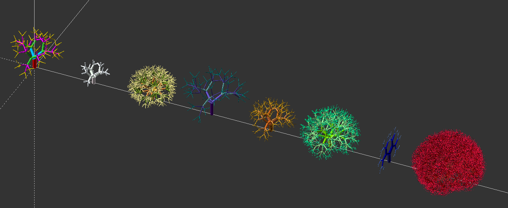
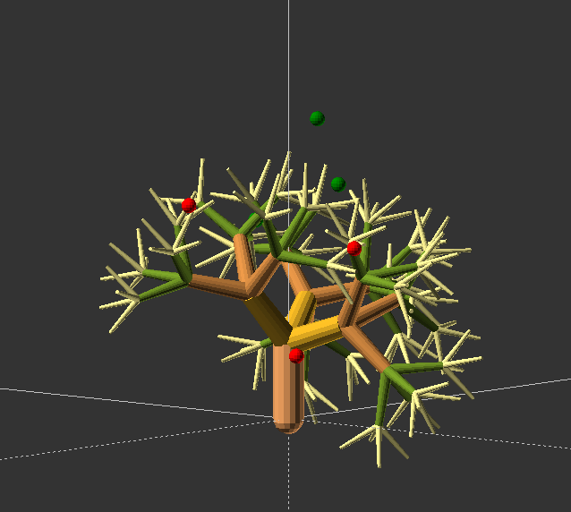

# GeoGrow

Recursive trees and flower shapes in OpenSCAD, from December 2023 and January
2024.

**Archived.** The tree work continues in
[L-System-SCAD](https://github.com/CameronBrooks11/L-System-SCAD), which grows
trees with seeded random rules, colour palettes, tapered branches, and growth
directed toward attract points and away from repel points. The flower files
are also in [BloomSCAD](https://github.com/CameronBrooks11/BloomSCAD), also
archived.

## What is here

| Path | What it is |
| --- | --- |
| `grow-vegetative/recur_tree_lib.scad` | `tree()`: a recursive tree of tapered cylinders, with eight colour palettes and optional random branch counts and angles. |
| `grow-vegetative/recur_tree_dir_lib.scad` | The same `tree()`, plus `attract_points` and `repel_points` meant to steer growth. Both files define `tree`, so use one at a time. |
| `tests/recur-trees-x8.scad` | Eight example trees side by side. |
| `grow-floral/rose-flower-geometry_lib.scad` | `rose_polygon()`: rose curves as 2D polygons. |
| `grow-floral/flower-path-FS_lib.scad` | `createFlower()`: random flower outlines from a Fourier series. |
| `grow-floral/grow-flower-geo_lib.scad` | `flower()`: a 3D flower with petals, centre, stem and leaves. |
| `grow-floral/tests/` | Example layouts for the three flower libraries. |
| `archive/`, `grow-floral/archive/` | Earlier versions. |

The libraries and the examples in `tests/` and `grow-floral/tests/` render
with OpenSCAD 2026.10.15 with warnings as errors; the eight-tree example takes
about 18 s.

## Known problems

These are why the trees were not taken further here.

- **Directed growth only steers the first branching.** The recursive call does
  not pass `attract_points` or `repel_points` on, so every level below the
  trunk uses the defaults, `[[100, 0, 300]]` and `[[-100, 0, 300]]`, and leans
  toward +x whatever points you give.
- **It steers backwards in y.** With the attractor at +y, the tree's centroid
  moved to y = -20.4; at -y, to +28.6. In x it moved the right way: +25.7 and
  -10.3.
- **The steering does not use the branch's position.** `cur_x` and `cur_y` add
  up branch angles in degrees, and the height is the branch length, so the
  direction to a point is not measured from where the branch is.
- **Some arguments do nothing.** `branch_d_factor` and `branch_len_factor` are
  read from file-level constants of the same name, so passing them changes
  nothing; `r` is never used. `ang_dec`, `ang_rand_var`, the branch offsets and
  the `fixed_*` flags apply to the first level only.
- **Every render is different.** `rands()` is never given a seed, so trees with
  random branching and the Fourier flowers change each time.

In L-System-SCAD, directed growth bends every segment toward the attract
points, and random rules are seeded.

## Credits

- The Fourier flower is adapted from
  [this post](https://openscadsnippetpad.blogspot.com/2017/06/flower-shape-path-fourier-series.html)
  on the OpenSCAD snippet pad blog.
- The rose curves were inspired by
  [this post](https://eribuijs.blogspot.com/2017/03/creating-mathematical-rose-in-openscad.html).
- The logo was rendered with
  [this script](https://gist.github.com/CameronBrooks11/26896bf8bafcc64d3f748a41d45be761).

## License

GPL-3.0. See [LICENSE](./LICENSE).
